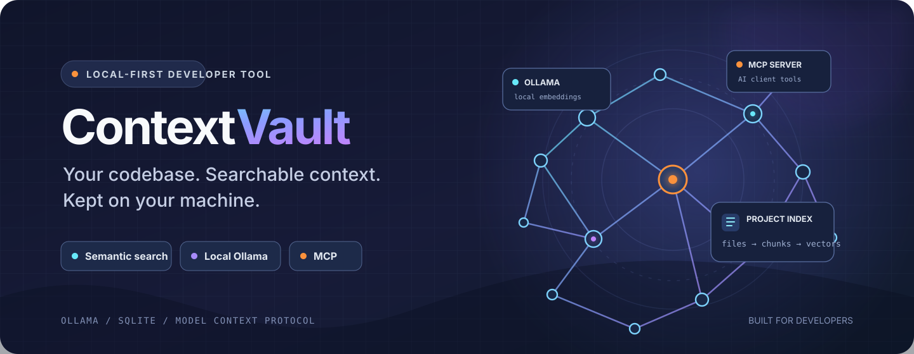

<!-- ContextVault repository landing page -->
<div align="center">
  

  <p><strong>Give your AI coding tools the context of your actual codebase — while keeping indexing and embeddings local.</strong></p>

  <p>
    <a href="https://github.com/ahmedfayedesmail-ui/contextvault/actions/workflows/ci.yml"></a>
    
    
    
    
    <a href="https://github.com/ahmedfayedesmail-ui/contextvault/stargazers"></a>
    <a href="https://github.com/ahmedfayedesmail-ui/contextvault/network/members"></a>
    
  </p>

  <p>
    <a href="https://ahmedfayedesmail-ui.github.io/contextvault/"><strong>Website</strong></a>
    ·
    <a href="#quick-start"><strong>Get started</strong></a>
    ·
    <a href="#connect-your-ai-tools-with-mcp"><strong>MCP setup</strong></a>
    ·
    <a href="#pricing"><strong>Pricing</strong></a>
  </p>
</div>

---

## What is ContextVault?

ContextVault is a **local-first developer context and memory system**. It indexes a project on your machine, creates searchable embeddings with local [Ollama](https://ollama.com/), and stores the index in SQLite.

Instead of relying only on filenames or exact keyword matches, you can ask questions in natural language and find relevant code. ContextVault also exposes project search and indexing through the **Model Context Protocol (MCP)** so compatible AI coding tools can request the context they need.

## At a glance

| Capability | What it does |
| --- | --- |
| **Project indexing** | Scans a local codebase and builds a searchable index. |
| **Semantic code search** | Finds relevant code using natural-language queries. |
| **Local embeddings** | Uses Ollama and the `nomic-embed-text` model for embedding generation. |
| **Persistent index** | Stores indexed project context in a local SQLite database. |
| **Live monitoring** | Watches an indexed project and adds new or changed files. |
| **MCP integration** | Exposes `search_context` and `index_project` to compatible AI clients. |
| **Cross-platform setup** | Includes native installers for Windows, macOS, and Linux, plus Docker. |

## How it works

```text
Your project folder
       │
       ▼
ContextVault scanner ──► Chunking and indexing
                               │
                               ▼
                        Local Ollama
                      (embeddings)
                               │
                               ▼
                       SQLite database
                         │         │
                         ▼         ▼
                    Web dashboard  MCP server
                                      │
                                      ▼
                              Compatible AI tools
```

Your project is indexed by the local ContextVault process. Embedding generation and semantic search use your local Ollama service; project source files are not automatically sent to a hosted embedding API.

## Quick start

Choose the installation method for your operating system. The native installers prepare Node.js, Ollama, the embedding model, project dependencies, and a launcher for the local dashboard.

### Windows 10 / 11

1. Download the repository using **Code → Download ZIP**, then extract it.
2. Right-click `install-contextvault.ps1` and choose **Run with PowerShell**.
3. The installer prepares a supported Node.js 22 runtime (using a verified official archive when needed), installs Ollama (using winget with a signed official-installer fallback), starts Ollama, downloads `nomic-embed-text`, and installs dependencies. It displays each stage, retries downloads, shows npm output, and saves a diagnostic log under `%LOCALAPPDATA%\\ContextVault\\logs`.
4. Open ContextVault and visit [http://localhost:3737](http://localhost:3737). The app warms the Ollama embedding model in the background at startup, so the dashboard can open immediately while the model is prepared for the first search.

### macOS

1. Download and extract the repository.
2. Double-click `install-mac.command`.
3. The installer uses Homebrew to prepare Node.js 22 and Ollama, downloads `nomic-embed-text`, installs dependencies, and creates a launcher.
4. Launch ContextVault and open the local dashboard.

### Linux

1. Download and extract the repository.
2. Run:

   ```bash
   chmod +x install-linux.sh && ./install-linux.sh
   ```

3. The installer supports APT- and DNF-based distributions, prepares Node.js 22 and Ollama, downloads `nomic-embed-text`, and creates an application shortcut.

### Docker

With Docker Engine or Docker Desktop and the Docker Compose plugin installed:

```bash
docker compose up --build
```

Then open [http://localhost:3737](http://localhost:3737). Docker Compose stores the SQLite database and Ollama model files in persistent volumes.

### Index your first project

1. Open the ContextVault dashboard.
2. Enter the full path to a local project folder in **Get started with ContextVault**.
3. Select **Index Project** and let the indexing job finish.
4. Ask a natural-language question in the search box.
5. Live monitoring adds new and changed files to the index automatically.

Files and folders excluded by the scanner's ignore rules are not indexed.

## Requirements

- **Windows:** Windows 10 22H2 or newer, or Windows 11.
- **macOS:** macOS 14 Sonoma or newer for the current Ollama distribution.
- **Linux:** A supported 64-bit APT- or DNF-based distribution, plus sudo access.
- **Docker:** Docker Engine or Docker Desktop with Docker Compose v2.
- **Node.js:** 22.13 or newer in the Node.js 22 release line (prepared by native installers).
- **Internet:** Required for first-time setup and downloading the embedding model.

See the [official Ollama Windows requirements](https://docs.ollama.com/windows) for platform details.

### Embedding performance

ContextVault warms the local Ollama embedding model when the dashboard starts and keeps it loaded for 30 minutes by default. Successful embedding requests log elapsed time and, when available, Ollama's model-load timing.

- `OLLAMA_KEEP_ALIVE` — defaults to `30m`.
- `OLLAMA_EMBED_TIMEOUT_MS` — defaults to `120000` (120 seconds).
- `OLLAMA_URL` — defaults to `http://localhost:11434`.

See [README_MCP.md](README_MCP.md#embedding-performance-and-diagnostics) for details.

## Connect your AI tools with MCP

ContextVault includes a local MCP server for compatible desktop clients. The dashboard generates a machine-specific configuration, including the active Node.js executable, MCP entry point, SQLite database path, local Ollama URL, and SQLite runtime option.

1. Start ContextVault and open [http://localhost:3737](http://localhost:3737).
2. Open **Settings**.
3. Under **AI Integrations**, select **Copy MCP Configuration**.
4. Paste the copied JSON into your AI client's MCP configuration.
5. Save the file and restart the desktop application.

### Claude Desktop

Common configuration file locations:

- **Windows:** `%APPDATA%\Claude\claude_desktop_config.json`
- **macOS:** `~/Library/Application Support/Claude/claude_desktop_config.json`
- **Linux:** `~/.config/Claude/claude_desktop_config.json`

Merge the generated `contextvault` entry into the existing `mcpServers` object. Keep your other server entries.

### Cursor

Use either:

- `.cursor/mcp.json` for project-specific configuration, or
- `~/.cursor/mcp.json` for global configuration.

Paste the generated JSON, save the file, and restart Cursor.

### Available MCP tools

| Tool | Purpose |
| --- | --- |
| `search_context` | Searches locally indexed project context. |
| `index_project` | Indexes a local project directory. |

## Manual development setup

Install Node.js 22 and Ollama, then run the following commands from the project directory:

```bash
npm install
ollama serve
ollama pull nomic-embed-text
npm run dev
```

Open [http://localhost:3737](http://localhost:3737). The health endpoint is available at [http://localhost:3737/health](http://localhost:3737/health).

## Available scripts

| Command | Purpose |
| --- | --- |
| `npm run dev` | Start the local development server. |
| `npm run build` | Compile the TypeScript application. |
| `npm start` | Start the compiled server. |
| `npm test` | Run the automated test suite. |
| `npm run lint` | Run ESLint on the source directory. |
| `npm run mcp` | Start the stdio MCP server for a compatible desktop client. |

## API endpoints

| Method | Endpoint | Purpose |
| --- | --- | --- |
| GET | `/health` | Application health check. |
| POST | `/api/scan` | Scan a project and return file metadata. |
| POST | `/api/index` | Index a project into the local database. |
| POST | `/api/search` | Search indexed context semantically. |
| GET | `/api/stats` | Return indexed file and chunk counts. |
| GET | `/api/config/mcp` | Generate a machine-specific MCP client configuration. |
| GET | `/api/settings/license` | Read the local license status. |
| PUT | `/api/settings/license` | Reset the local license selection to Free. |
| POST | `/api/license/activate` | Validate a Lemon Squeezy license key and activate Pro. |
| POST | `/api/watch` | Start live monitoring for a project. |

## Local storage

The default SQLite database is created at `data/contextvault.db`.

| Setting | Default |
| --- | --- |
| `PORT` | `3737` |
| `OLLAMA_URL` | `http://localhost:11434` |
| `DATABASE_PATH` | `data/contextvault.db` |

Set `DATABASE_PATH` to use a different local SQLite database file. Keep it consistent between the web application and MCP client when both should use the same index.

## Pricing

ContextVault Pro is available in two billing periods:

| Plan | Price |
| --- | ---: |
| **Pro Monthly** | **$9 / month** |
| **Pro Yearly** | **$79 / year** |

To upgrade, open **Settings → Upgrade to Pro** and choose a billing period in Lemon Squeezy checkout. After purchase, enter the license key sent by Lemon Squeezy in **Settings → Activate Pro**. ContextVault validates the key and activates Pro when the key is valid.

[**Choose a Pro plan**](https://witness-engine.lemonsqueezy.com/checkout/buy/2e74fe7c-547a-4483-b09d-5699d6a1b422)

The license activation endpoint is `POST /api/license/activate`.

## Project links

- **Website:** [ahmedfayedesmail-ui.github.io/contextvault](https://ahmedfayedesmail-ui.github.io/contextvault/)
- **Source code:** [GitHub repository](https://github.com/ahmedfayedesmail-ui/contextvault)
- **MCP configuration guide:** [README_MCP.md](README_MCP.md)

## License

License terms have not been published in the repository. No open-source license is implied until a license file is added.

---

<div align="center">
  <strong>ContextVault</strong><br />
  <sub>Useful project context, close to the code and under your control.</sub>
</div>
